<div align="center">



<br/>

<a href="https://github.com/eternalnetwork">
  
</a>

<br/><br/>


</div>


### `∞ whoami`

```solidity
// SPDX-License-Identifier: MIT
pragma solidity ^0.8.24;

contract Eternal {
    string  public constant role     = "Web3 Engineer";
    string  public constant mission  = "Make value move as freely as information";
    string[] public focus = [
        "Smart contracts & protocol design",
        "DeFi primitives & on-chain liquidity",
        "Cross-chain messaging & bridges",
        "Zero-knowledge & privacy tech",
        "Account abstraction (ERC-4337)",
        "Smart contract security"
    ];

    bool public constant custodial = false;   // never
    bool public constant shipping  = true;    // always

    function gm() external pure returns (string memory) {
        return "wagmi";
    }
}
```


### `◈ what I build with`

<table>
<tr>
<td width="50%" valign="top">

**⛓ Protocol layer**
- Solidity & Vyper smart contracts
- Upgradeable proxies, diamonds, factories
- Gas-optimized, audit-ready code
- ERC-20 · ERC-721 · ERC-1155 · ERC-4626 · ERC-4337

</td>
<td width="50%" valign="top">

**◎ DeFi**
- AMMs, swaps & routing
- Lending, vaults & yield strategies
- Oracles & price feeds
- MEV awareness & slippage protection

</td>
</tr>
<tr>
<td width="50%" valign="top">

**⇄ Interop**
- Cross-chain messaging & bridges
- Multi-chain deployments (EVM + Solana)
- Indexing with subgraphs & event pipelines
- Wallet connections & signing flows

</td>
<td width="50%" valign="top">

**◉ Security & privacy**
- Threat modeling & invariant testing
- Fuzzing with Foundry & Echidna
- Static analysis (Slither, Mythril)
- ZK circuits & privacy-preserving design

</td>
</tr>
</table>


### `⚙ stack`

**Languages**


**Chains**


**Tooling**


**Infra & data**


### `§ principles`

```diff
+ Non-custodial by default. Your keys, your coins.
+ Audit before you ship. Test the invariants, not just the happy path.
+ Gas is UX. Every opcode is paid for by a real person.
+ Permissionless > permissioned. Open source > closed.
+ Privacy is a feature, not a loophole.
- Trust me bro.
```


### `⛏ latest blocks`




### `◇ currently researching`

<table>
<tr>
<td width="50%" valign="top">

**Execution & UX**
- EIP-7702: smart accounts for every EOA
- Intents, solvers & order-flow auctions
- Chain abstraction: one balance, any chain
- Passkeys & session keys instead of seed phrases

</td>
<td width="50%" valign="top">

**Scaling & trust**
- Based & native rollups
- ZK coprocessors & proof aggregation
- Restaking & shared security
- FHE & MPC for private on-chain state

</td>
</tr>
</table>


### `⧗ the eternal ledger`

```text
#0          2009-01-03   Bitcoin genesis block. Peer-to-peer cash begins.
#1          2010-05-22   10,000 BTC for two pizzas. Price discovery begins.
#2          2015-07-30   Ethereum mainnet. Money becomes programmable.
#3          2020-06      DeFi summer. Lending, AMMs and yield go permissionless.
#4          2022-09-15   The Merge. Proof-of-stake, ~99.95% less energy.
#5          2024-03-13   Dencun. EIP-4844 blobs make L2s cheap.
#6          2025-05-07   Pectra. EIP-7702 brings smart accounts to every wallet.
#∞          next         Whatever we build on top. Commit → branch → merge → repeat.
```


### `$ tx receipt`

```json
{
  "status": "0x1",
  "from": "eternal",
  "to": "the decentralized web",
  "value": "∞",
  "gasUsed": "every opcode, accounted for",
  "logs": ["Built()", "Audited()", "Shipped()", "Repeat()"],
  "confirmations": "forever"
}
```

<details>
<summary><b>📖 gm glossary</b> (for the frens just arriving)</summary>

<br/>

| term | meaning |
|---|---|
| **gm** | Good morning. Said at any hour, on any chain. |
| **wagmi / ngmi** | We're all gonna make it / not gonna make it. |
| **ser** | Respectful address. "Wen mainnet, ser?" |
| **fren** | A friend who also reads whitepapers. |
| **hodl** | Hold through the volatility. Born from a typo in 2013. |
| **rekt** | What happens when you skip the audit. |
| **degen** | Apes in first, reads the contract later. |
| **NFA / DYOR** | Not financial advice. Do your own research. |
| **few understand** | The idea is early and you're on time. |

</details>


<div align="center">

<sub>
<code>0x…</code> is just a number. What you build on it lasts forever.
<br/>
<b>gm</b> ∞
</sub>

</div>
